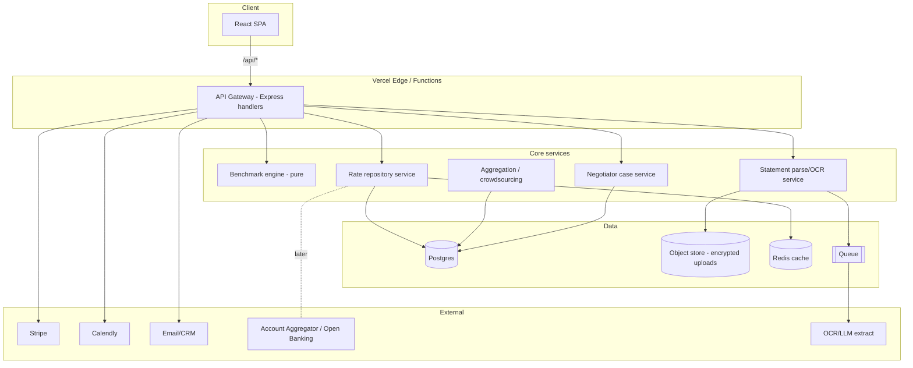

# Backend Roadmap — BankBenchmark.sg

How the backend evolves from the current prototype into a production system, and
the process we use to get there. Read alongside [scope.md](scope.md) (strategy,
failure modes, compliance) and [TESTING.md](TESTING.md) (test approach).

> Guiding rule: **ship the smallest backend that makes the next user promise real.**
> Every phase must leave the product deployable, tested, and privacy-safe.

---

## 0. Where we are today (baseline)

| Area | Current state | File(s) |
| --- | --- | --- |
| API | Express app run as a Vercel serverless function | `server/app.js`, `api/[...path].js` |
| Benchmark logic | Pure, in-memory functions | `server/benchmark.js` |
| Rate repository | Hard-coded illustrative data | `server/data.js` |
| Endpoints | `GET /api/reference`, `POST /api/benchmark`, `POST /api/parse`, `POST /api/reveal` (stub), `GET /api/health` | `server/app.js` |
| Statement parsing | Regex heuristics, no upload/OCR | `server/benchmark.js` → `parseStatement()` |
| Persistence | **None** (stateless) | — |
| Auth | **None** | — |
| Payments / calls / email | **Stubbed** in the UI (JourneyModal) | client only |
| Tests | 23 unit + integration (`node:test`) | `server/test/*` |

**Strengths to preserve:** pure logic that's trivially testable; stateless by default;
bank identity masked until reveal; no personal data stored.

---

## 1. Guiding principles (backend)

1. **Privacy-by-design is a hard constraint, not a feature.** Segregate identifying
   vs. benchmarking data; anonymise early; publish only aggregates. (scope.md §11)
2. **Keep pure logic pure.** `benchmark.js` stays free of I/O so it's testable and
   reusable across the API, workers, and batch jobs.
3. **Stateless until state earns its keep.** Add a DB only when a promise needs
   memory (accounts, saved reports, crowdsourced data, negotiator cases).
4. **Serverless-first, service-when-needed.** Short request/response → Vercel
   functions. Long/async (OCR, ingestion, negotiator workflow) → queue + worker.
5. **Every external effect behind an interface.** Payments, email, calendar, OCR,
   and bank-data access are adapters, so providers can be swapped per market.
6. **Contract stability.** The client depends on the `/api` shapes — version them
   and never break `reference`/`benchmark` without a migration.

---

## 2. Target architecture



**Migration note:** we stay on Vercel functions as long as requests are short. The
first thing that forces a persistent worker is **async statement OCR** (Phase 2) —
introduce a queue + worker then, not before.

---

## 3. Phased roadmap

Each phase lists the backend deliverables, new endpoints, and the data it needs.

### Phase 1 — Foundations (persist leads, real notifications)
**Goal:** make the JourneyModal promises real without heavy infra.

- **Datastore:** managed Postgres (Neon / Supabase / Vercel Postgres). Add a thin
  data layer (`server/db/`), migrations (Drizzle or Prisma).
- **Lead capture:** replace the `/api/reveal` stub with a persisted `leads` record +
  transactional email (Resend/Postmark) and CRM sync (HubSpot optional).
- **Config out of code:** move `data.js` rates into a `rates` table seeded from the
  current file; keep `benchmark.js` reading an injected repository (dependency
  inversion) so tests still pass with fixtures.
- **Env & secrets:** Vercel project env vars; `.env.example` committed.

New/changed endpoints:
```
POST /api/leads            { email, intent, segment, context } -> persists + emails
POST /api/reveal           gated: requires lead + (later) payment
GET  /api/reference        now reads rates repo (cache 5 min)
```

Exit criteria: a submitted email is stored, emailed, and visible in an admin query;
`benchmark.js` unit tests unchanged.

---

### Phase 2 — Statement upload & extraction (the core wedge)
**Goal:** move from "paste text" to "upload a statement," which is the real value.

- **Upload:** `POST /api/uploads` → signed URL to encrypted object storage (S3/R2,
  SSE-AES-256). Never store raw files on the function.
- **Async pipeline:** enqueue an extraction job → worker runs OCR/LLM extraction →
  writes **only** derived, minimised metrics (fees, margins, volumes) to `statements`
  and **discards/masks** PII (beneficiary names, references, account numbers).
- **Parser upgrade:** keep `parseStatement()` as the deterministic fallback; add a
  structured extractor (LLM or table-parser) behind a `StatementExtractor` interface.
- **Retention:** raw upload TTL ≤ 90 days (auto-delete job); anonymised metrics kept.

New endpoints:
```
POST /api/uploads          -> { uploadUrl, uploadId }
POST /api/uploads/:id/parse-> enqueue extraction (202 Accepted)
GET  /api/uploads/:id      -> status + itemised benchmark when ready
```

Infra added: queue (Vercel Queues / SQS / QStash) + a worker (Vercel background
function or a small dedicated service). **This is the point we stop being 100%
serverless-simple.**

Exit criteria: upload a PDF/CSV → itemised, masked benchmark returned; PII never
persisted; raw file deletable on request.

---

### Phase 3 — Accounts, payments & bookings (monetise the journey)
**Goal:** turn the modal steps into real transactions.

- **Auth:** lightweight auth (Clerk/Auth.js) — optional account to save reports and
  track negotiator cases. Anonymous benchmarking still works without login.
- **Payments:** Stripe adapter. `reveal`/report unlock = one-off PaymentIntent;
  webhook confirms → unlock. Concierge = success-fee invoicing later.
- **Bookings:** Calendly (or Cal.com) adapter; store booking refs on the lead/case.
- **Reveal gating:** the winning provider is returned **only** after payment/booking
  confirmation server-side (never trust the client).

New endpoints:
```
POST /api/checkout             { action, context } -> Stripe session/intent
POST /api/webhooks/stripe      payment confirmation -> unlock reveal
POST /api/bookings             { slot, action, email } -> Calendly + persist
GET  /api/reports/:id          gated full report (post-payment)
```

Exit criteria: a $1 reveal actually unlocks the bank name server-side after a real
(test-mode) Stripe payment; bookings recorded.

---

### Phase 4 — Crowdsourced benchmarks & realised rates (the moat)
**Goal:** benchmarks become percentiles from consented data + negotiator outcomes.

- **Aggregation service:** nightly job computes **medians/percentiles** per
  `(product × corridor × segment)` from consented `statements` and closed negotiator
  cases. Enforce a **k-anonymity threshold** (e.g. ≥ N contributors) before a cell is
  publishable — otherwise fall back to panel data.
- **Rate ingestion:** scheduled connectors for public card/board rates (per bank),
  plus a broker/panel feed for realised rates. Versioned, with provenance.
- **Benchmark engine v2:** returns a distribution (`p10/p50/p90`) and confidence, not
  a single point; labels everything indicative until a cell is dense.
- **Negotiator data loop:** every closed case writes an anonymised realised rate back
  into the dataset — the flywheel from scope.md §5.1.

New endpoints:
```
GET  /api/benchmark/distribution?product=&corridor=&segment=
POST /api/contribute            opt-in: promote a parsed statement into the pool
(internal) cron: aggregate-benchmarks, ingest-rates, purge-raw-uploads
```

Exit criteria: at least one `(product × corridor)` cell shows a real percentile band
sourced from ≥ N consented contributions; sparse cells transparently fall back.

---

### Phase 5 — Negotiator workflow & marketplace
**Goal:** operationalise the success-fee concierge and consultant marketplace.

- **Case management:** `negotiator_cases` with a state machine
  (`intake → baseline_signed → contacting_bank → offer → savings_locked → billed`).
- **Baseline & attribution:** capture a signed pre-negotiation baseline; compute
  realised savings as delta over 12 months; success fee billed on documented delta.
- **Marketplace:** independent consultant accounts, assignment, and referral tracking
  (keep advisory with licensed third parties — scope.md §11 positioning).
- **Audit:** immutable event log per case (who/what/when/consent).

New endpoints:
```
POST /api/cases                 open a case from a benchmark
PATCH/api/cases/:id             advance state (role-guarded)
GET  /api/cases/:id/timeline    audit trail
POST /api/consultants/apply     marketplace onboarding
```

---

## 4. Data model (first cut)

Two-class separation is mandatory (scope.md §11): **identifying** vs **benchmarking**.

```sql
-- Identifying (short-lived / encrypted / deletable)
leads(id, email_enc, segment, intent, source, created_at, deleted_at)
uploads(id, lead_id, object_key, status, checksum, expires_at, created_at)
consents(id, lead_id, version, scope, granted_at, revoked_at)  -- versioned + audited

-- Benchmarking (anonymised, retained)
statements(id, segment, product, corridor, metrics_jsonb, anonymised_at)
  -- metrics only: fees, margins, volumes, counts. NO names/refs/account numbers.
rates(id, bank, product, variant, corridor, rate_type, value, kind, source,
      effective_from, provenance)                                  -- from data.js, versioned
benchmarks_agg(product, corridor, segment, p10, p50, p90, n, updated_at)

-- Commerce / workflow
payments(id, lead_id, stripe_id, action, amount, status, created_at)
bookings(id, lead_id, provider_ref, action, slot, status)
negotiator_cases(id, lead_id, state, baseline_jsonb, realised_savings, fee, ...)
audit_events(id, entity, entity_id, actor, action, meta_jsonb, at)  -- append-only
```

Rules:
- `email_enc` and anything identifying → encrypted at rest (AES-256), access-controlled.
- `statements.metrics_jsonb` is written by the extraction worker **after** PII stripping.
- A row in `benchmarks_agg` is only *published* when `n ≥ k` (k-anonymity).

---

## 5. API surface (evolution summary)

| Endpoint | Phase | Notes |
| --- | --- | --- |
| `GET /api/health` | ✅ now | keep |
| `GET /api/reference` | ✅→P1 | read from `rates` repo + cache |
| `POST /api/benchmark` | ✅→P4 | add distribution mode |
| `POST /api/parse` | ✅→P2 | deterministic fallback; async for uploads |
| `POST /api/reveal` | ✅→P3 | gated by payment/booking server-side |
| `POST /api/leads` | P1 | persist + email |
| `POST /api/uploads*` | P2 | signed URL + async extraction |
| `POST /api/checkout`, `…/webhooks/stripe` | P3 | payments |
| `POST /api/bookings` | P3 | Calendly/Cal.com |
| `GET /api/benchmark/distribution` | P4 | percentiles |
| `/api/cases*`, `/api/consultants*` | P5 | negotiator + marketplace |

Version with an `/api/v1` prefix before the first breaking change.

---

## 6. Cross-cutting concerns

### Security & privacy (non-negotiable)
- TLS in transit; AES-256 at rest; encrypt identifying columns/fields.
- Data minimisation at ingestion — strip beneficiary names, references, account
  numbers before any storage.
- Consent management with **versioning + audit log**; honour **right-to-delete**
  (cascade delete identifying data + raw uploads).
- Rate-limit public endpoints; validate & clamp all inputs (already done in
  `computeBenchmark`); add a payload size cap (already `256kb`).
- Secrets in Vercel env / a secrets manager — never in the repo.
- Webhook signature verification (Stripe/Calendly).

### Compliance (per market — scope.md §11)
- **SG:** PDPA + MAS TRM best practice; no deposit-taking/advice/payment-initiation.
- **India:** DPDP 2023; no scraping — bank-linked data only via **Account Aggregator**.
- **Malaysia:** PDPA 2010; BNM expectations.
- Gate any "connect my bank" feature behind a per-market legal review; keep it a
  separate service so the core platform's risk profile stays low.

### Observability & ops
- Structured logging (no PII in logs), request IDs, error tracking (Sentry).
- Metrics: activation, parse success rate, reveal conversion, negotiator win rate.
- Uptime + synthetic checks on `/api/health` and a benchmark round-trip.

### Testing & CI/CD
- Keep `benchmark.js` unit tests green as it gains a repository interface (inject a
  fixture repo).
- Add contract tests for each endpoint (extend `server/test/api.test.js`).
- Integration tests against an ephemeral Postgres (Testcontainers or a CI service DB).
- CI: run `npm test` (server) + `npm run build` (client) on every PR; block on red.
- Preview deploys per PR (Vercel) for the frontend + functions.

---

## 7. How we process things further (working method)

1. **One promise at a time.** Pick the next user-facing promise (e.g. "upload a
   statement"), and build only the backend that makes it true. Avoid speculative
   tables/services.
2. **Design the contract first.** Write the endpoint shape + example payloads, get
   the client wired against a mock, then implement the real handler.
3. **Pure core, thin edges.** New computation goes into pure modules (like
   `benchmark.js`); handlers stay as glue. This keeps tests fast and logic portable.
4. **Migrations are code.** Every schema change is a reviewed migration; never edit
   prod data by hand. Seed from `data.js` so history is reproducible.
5. **Feature-flag risky work.** Payments, uploads, and crowdsourcing land behind
   flags so we can ship dark and enable per environment.
6. **Privacy review is a checklist item on every PR** that touches data: what's
   collected, why, retention, anonymisation, consent, deletion path.
7. **Branch & deploy** (matches current setup): feature branch → PR → CI green →
   preview deploy → review → merge → production deploy. The prototype lives on its
   own branch/Vercel project; production graduates when a phase's exit criteria pass.
8. **Definition of done per phase:** endpoints documented, tests added, privacy
   checklist signed, deployed to staging, exit criteria demonstrably met.

---

## 8. Immediate next steps (start of Phase 1)

- [ ] Add Postgres + a `db/` layer and migrations; seed `rates` from `data.js`.
- [ ] Refactor `benchmark.js`/`app.js` to read rates via an injected repository
      (no behavioural change; tests use a fixture repo).
- [ ] Replace `/api/reveal` stub with `POST /api/leads` (persist + Resend email).
- [ ] Add `.env.example`, wire secrets in Vercel, add Sentry + request logging.
- [ ] Extend `server/test` with a DB-backed integration test and a `/api/leads`
      contract test.
- [ ] Write the Phase 2 upload/extraction design doc (storage, queue, PII stripping)
      before writing code.

> North star: the backend exists to (a) prove savings honestly, (b) earn trust to be
> given statements, and (c) turn negotiator outcomes into a realised-rate dataset —
> the flywheel in [scope.md](scope.md). Build in that order.
